# taproot

Taproot is one server that pools your Claude and Codex subscription accounts behind one endpoint on your tailnet. Claude Code and Codex on every device you allow send their requests to it, and taproot spreads them across the accounts. Its dashboard shows accounts, quota, usage and cost, request logs, backups, and alerts.

Only devices on your tailnet can reach taproot, and it decides what each device may do by its Tailscale identity. There are no API keys to hand out.

> [!WARNING]
> Read [Terms of service](#terms-of-service) and [Security](#security) before you add an account. Using subscription credentials through a proxy can break the provider's terms, and a misconfigured taproot gives your OAuth tokens to anyone who can reach its port.

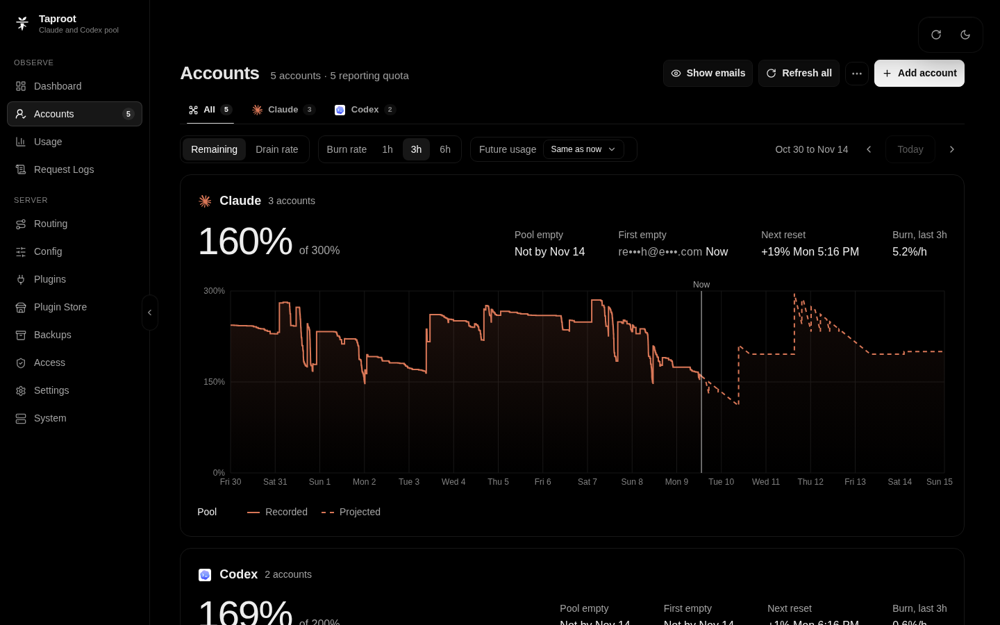

<sub>Screenshots use synthetic demo data. See [The dashboard](#the-dashboard).</sub>

Taproot is for one person, or one household, with a Linux server on a Tailscale tailnet and more than one Claude or Codex subscription. It is not a multi-tenant service and has no user accounts of its own. It is a fork of [CLIProxyAPI](https://github.com/router-for-me/CLIProxyAPI) and adds these features:

- **Soonest-reset-first routing.** New sessions go to the account whose weekly window resets soonest, so quota that is about to reset is spent first. A running session stays on its account.
- **Quota ledger.** Taproot records every account's 5-hour and weekly use and projects when each pool runs empty.
- **Usage and cost.** Requests, tokens, latency, and failures by account, model, session, and device, priced at API rates from an editable table.
- **Request logs.** Every request and response, compressed, searchable, and deleted by age or total size.
- **Backups.** A daily archive of the configuration, credentials, and database, which you can download or restore from the dashboard.
- **Discord alerts.** A limit hit, an empty pool, a broken login, and an expiring Claude reset grant.

CLIProxyAPI's other providers still work through the proxy, without quota tracking or routing.

## Quick start

These steps run the published image with rootless Podman. They take you from an empty host to a proxied request.

### 1. Check the prerequisites

- A Linux host, amd64 or arm64, on your tailnet, with `tailscaled` running.
- Rootless Podman 5 or later, or rootful Docker. Rootless Docker does not work: it shows taproot every caller as its bridge address, so no device can be identified, and taproot refuses them all.
- A second device on the same tailnet, with a browser, for the dashboard.

Taproot runs on Linux only. It identifies callers through the host's `tailscaled` socket and needs a container runtime that keeps each caller's address, and Docker Desktop on macOS and Windows has neither.

### 2. Start the container

```sh
mkdir -p "$HOME/taproot/data"
podman run -d --name taproot --restart unless-stopped \
  --network pasta \
  -e TZ=Etc/UTC \
  -v "$HOME/taproot/data:/taproot/config" \
  -v /var/run/tailscale/tailscaled.sock:/var/run/tailscale/tailscaled.sock \
  -p "$(tailscale ip -4):8317:8317" \
  ghcr.io/265866/taproot:0.2
```

On the first start, taproot writes `config.yaml` and `taproot.yaml` into `~/taproot/data`. `--network pasta` keeps each caller's source address, which taproot uses to identify the caller. `TZ` sets the time of the daily backup. On an SELinux host, add `:Z` to the data volume.

With rootful Docker, run the same command with `docker run`, leave out `--network pasta`, and add `--user "$(id -u):$(id -g)"`, so the process runs as the owner of the data directory.

Rootless Podman does not start this container again after the host reboots. To run taproot as a service, use one of the setups in [Install](#install). They use the same data directory.

### 3. Claim the server

While no device has Admin, taproot logs a setup code each time it starts:

```sh
podman logs taproot 2>&1 | grep 'setup code [A-Z0-9]'
```

On the device you will manage taproot from, open the URL in that line, `http://<server>:8317/`. `<server>` is the host's MagicDNS name or Tailscale address. The line always shows port 8317; if you published another port, use that one. Enter the code and select **Claim this server**. That device gets Proxy and Admin, and the code stops working.

### 4. Add an account

On the dashboard, go to **Accounts** and select **Add account**.

1. Select Claude or Codex under **Sign in with a provider**, then select **Open Link** in the dialog to open the provider's sign-in page.
2. Sign in. The provider then sends you to a `http://localhost:...` address, which does not load.
3. Copy the full address from the address bar, paste it into **Callback URL**, and select **Submit Callback URL**.

To move an existing credential instead, select **Upload auth file** and choose its JSON file. Use each account with one proxy only. Claude rotates refresh tokens, so two proxies that refresh the same account sign each other out.

### 5. Point Claude Code or Codex at taproot

Taproot ignores the API key, so clients send any placeholder.

For Claude Code, set these variables in your shell profile:

```sh
export ANTHROPIC_BASE_URL="http://<server>:8317"
export ANTHROPIC_AUTH_TOKEN="taproot"
```

For Codex, add this to `~/.codex/config.toml` (see [Codex advanced configuration](https://learn.chatgpt.com/docs/config-file/config-advanced)):

```toml
model_provider = "taproot"

[model_providers.taproot]
name = "taproot"
base_url = "http://<server>:8317/v1"
wire_api = "responses"
```

To check the proxy from that device, list the models. The list includes the models of the accounts you added:

```sh
curl http://<server>:8317/v1/models
```

To let another device use the proxy, turn on **Proxy** for it on the dashboard's **Access** page.

## Install

Each setup below runs taproot as a service that starts at boot. All of them keep the same files in the data directory:

| Path | Contents |
| --- | --- |
| `config.yaml`, `taproot.yaml` | Configuration, written on the first start |
| `auths/` | OAuth credential files |
| `taproot/taproot.db` | Usage, quota, and the request-log index (SQLite) |
| `taproot/request-logs/` | Compressed request logs |
| `taproot/backups/` | Backup archives |

The data directory holds your OAuth refresh tokens and every prompt. Treat it, and every backup, like a password. Mount the whole directory into a container, not single files. Restoring a backup replaces the files by rename, which fails on a single-file mount.

A backup also holds the Codex refresh journal, `auths/.codex-refresh/`, where taproot records each Codex token refresh before it sends it. A restore adds the journal entries the auth directory lacks before it puts the credentials back, and never deletes one, so a restore does not make taproot resend a Codex refresh token that the journal records as sent. Do not copy Codex credentials between machines without that directory. Backups leave out `auths/kv.db`, a cache that taproot rebuilds.

### Podman quadlet

[`examples/taproot/taproot.container`](examples/taproot/taproot.container) runs taproot as a systemd user service under rootless Podman. It uses a read-only root filesystem, drops every capability, and publishes the port on the host's Tailscale address only. If you started taproot with the Quick start command, run `podman rm -f taproot` first.

```sh
mkdir -p "$HOME/taproot/data" "$HOME/.config/containers/systemd"
curl -fsSL -o "$HOME/.config/containers/systemd/taproot.container" \
  https://raw.githubusercontent.com/265866/taproot/taproot-v0.2.0/examples/taproot/taproot.container
sed -i "s/^PublishPort=100\.64\.0\.1:/PublishPort=$(tailscale ip -4):/" \
  "$HOME/.config/containers/systemd/taproot.container"
podman pull ghcr.io/265866/taproot:0.2
systemctl --user daemon-reload
systemctl --user start taproot
loginctl enable-linger "$USER"
journalctl --user -u taproot | grep 'setup code [A-Z0-9]'
```

The quadlet runs `ghcr.io/265866/taproot:0.2` and pulls it only when the host does not have it, so an update waits until you pull. `loginctl enable-linger` keeps the service running when you are not signed in. Run the quadlet as your own user, without `User=` or `UserNS=`. Podman maps the container's root to your user, which owns the files in the data directory.

### Docker Compose

[`examples/taproot/compose.yaml`](examples/taproot/compose.yaml) runs taproot under rootful Docker with the same restrictions as the quadlet. It reads the host's Tailscale address and your user and group IDs from a `.env` file beside it.

```sh
mkdir -p "$HOME/taproot/data"
cd "$HOME/taproot"
curl -fsSLO https://raw.githubusercontent.com/265866/taproot/taproot-v0.2.0/examples/taproot/compose.yaml
printf 'TS_IP=%s\nTAPROOT_USER=%s:%s\n' "$(tailscale ip -4)" "$(id -u)" "$(id -g)" > .env
docker compose up -d
docker compose logs taproot | grep 'setup code [A-Z0-9]'
```

Create `data/` before the first `docker compose up`. Otherwise Docker creates it as root, and taproot cannot write to it.

### NixOS

The flake's NixOS module, `services.taproot`, builds taproot from source and runs it as a hardened systemd service after `tailscaled.service`. Add the flake to your system flake and enable the module:

```nix
{
  inputs.nixpkgs.url = "github:NixOS/nixpkgs/nixos-unstable";
  # A release tag. Without one, the input follows unreleased commits on main.
  inputs.taproot.url = "github:265866/taproot/taproot-v0.2.0";
  inputs.taproot.inputs.nixpkgs.follows = "nixpkgs";

  outputs = { nixpkgs, taproot, ... }: {
    nixosConfigurations.server = nixpkgs.lib.nixosSystem {
      system = "x86_64-linux";
      modules = [
        taproot.nixosModules.default
        {
          services.tailscale.enable = true;
          services.taproot = {
            enable = true;
            # This host's address from `tailscale ip -4`. Taproot listens only there.
            tailscale.address = "100.64.0.1";
            openFirewall = true;
            timeZone = "Etc/UTC";
            # Copied to taproot.yaml on the first start only.
            taprootSettings.access.devices = [
              { id = "nEXAMPLE1CNTRL"; name = "laptop"; proxy = true; admin = true; }
            ];
          };
        }
      ];
    };
  };
}
```

The module keeps loopback callers out and requires `taprootSettings`, so give Admin there to the device you manage taproot from. Its stable ID is the `ID` that `tailscale status --json` prints under `Self` on that device.

Nix owns `config.yaml` and writes it from `services.taproot.settings` on every start, so a dashboard change to it lasts until the next restart. Nix only seeds `taproot.yaml` from `taprootSettings` while the file does not exist. After that the dashboard owns `taproot.yaml`, and later changes to `taprootSettings` do not apply. The data directory is `/var/lib/taproot`. [`nix/module.nix`](nix/module.nix) documents every option.

### Plain binary with systemd

Each release has a tarball for linux-amd64 and linux-arm64. The binary needs glibc 2.34 or later, so it runs on Debian 12, Ubuntu 22.04, and later, but not on musl distributions such as Alpine. You need the [GitHub CLI](https://cli.github.com/) to check the tarball's attestation.

```sh
v=0.2.0
arch=amd64   # or arm64
gh release download "taproot-v$v" --repo 265866/taproot \
  --pattern "taproot-$v-linux-$arch.tar.gz" --pattern SHA256SUMS
sha256sum --ignore-missing -c SHA256SUMS
gh attestation verify "taproot-$v-linux-$arch.tar.gz" --repo 265866/taproot \
  --cert-identity-regex '^https://github\.com/265866/taproot/\.github/workflows/release\.yml@refs/tags/taproot-v'
sudo tar -xzf "taproot-$v-linux-$arch.tar.gz" -C /opt
sudo ln -sfn "/opt/taproot-$v-linux-$arch" /opt/taproot
```

The tarball holds the `taproot` binary with `LICENSE`, `THIRD_PARTY_NOTICES.md`, `web/LICENSE`, and `licenses/`. Keep those files beside the binary. The binary includes LGPL-licensed code, and the LGPL requires its notices to go with every copy you pass on.

Outside a container, every process on the host can connect from loopback, and taproot treats loopback callers as admins. [`examples/taproot/taproot.service`](examples/taproot/taproot.service) drops loopback traffic for that reason, and taproot must listen on the host's Tailscale address. Write the configuration before the first start:

```sh
sudo useradd --system --home-dir /var/lib/taproot --shell /usr/sbin/nologin taproot
sudo install -d -m 0700 -o taproot -g taproot /var/lib/taproot
curl -fsSL "https://raw.githubusercontent.com/265866/taproot/taproot-v$v/examples/taproot/config.yaml" \
  | sed -e "s|host: \"0.0.0.0\"|host: \"$(tailscale ip -4)\"|" \
        -e 's|/taproot/config/auths|/var/lib/taproot/auths|' \
  | sudo install -m 0600 -o taproot -g taproot /dev/stdin /var/lib/taproot/config.yaml
sudo install -m 0600 -o taproot -g taproot /dev/null /var/lib/taproot/taproot.yaml
sudo curl -fsSL -o /etc/systemd/system/taproot.service \
  "https://raw.githubusercontent.com/265866/taproot/taproot-v$v/examples/taproot/taproot.service"
sudo systemctl daemon-reload
sudo systemctl enable --now taproot
sudo journalctl -u taproot | grep 'setup code [A-Z0-9]'
```

A browser on the server itself connects as the server's own node, which never gets Admin, so it cannot claim the server or open the dashboard. Claim the server from another device.

## Verify a release

Releases are built by the release workflow in this repository. Each image has a GitHub build attestation and a keyless cosign signature, and each tarball has a GitHub build attestation. To check the image you pulled before you run it, verify its digest rather than its tag, which can move between the pull and the check. This needs [cosign](https://github.com/sigstore/cosign/releases):

```sh
podman pull ghcr.io/265866/taproot:0.2
ref=$(podman image inspect --format '{{index .RepoDigests 0}}' ghcr.io/265866/taproot:0.2)
identity='^https://github\.com/265866/taproot/\.github/workflows/release\.yml@refs/tags/taproot-v0\.2\.[0-9]+$'
cosign verify "$ref" \
  --certificate-identity-regexp "$identity" \
  --certificate-oidc-issuer https://token.actions.githubusercontent.com
```

The identity names the release line, so an image signed for a prerelease or another minor version does not pass. The release signs the multi-arch index and each platform's image, so the check passes on whichever digest Podman recorded. With Docker, as in the Docker Compose setup, run `docker pull` and `docker image inspect` with the same arguments instead.

To check a release's build attestation, run `gh attestation verify oci://ghcr.io/265866/taproot:0.2.0 --repo 265866/taproot --cert-identity-regex "$identity"`. The attestation covers only the multi-arch index, which the tag names, so it does not verify the platform digest that Podman can record.

[Plain binary with systemd](#plain-binary-with-systemd) shows the checks for a tarball. Image tags are `X.Y.Z` for one release, `X.Y` for the newest release of a minor version, and `latest`.

## Update

Updates are manual unless you turn on the [automatic updater](#automatic-updates-optional). A restart cuts the requests that are running through taproot, so update when your agents are idle.

| Setup | Update |
| --- | --- |
| Quick start container | `podman pull ghcr.io/265866/taproot:0.2`, then `podman rm -f taproot` and run the Quick start command again |
| Podman quadlet | `podman pull ghcr.io/265866/taproot:0.2 && systemctl --user restart taproot` |
| Docker Compose | `docker compose pull && docker compose up -d` |
| NixOS | Change the tag in `inputs.taproot.url` to the new release, such as `taproot-v0.2.1`, then run `nix flake update taproot` and `nixos-rebuild switch` |
| Plain binary | Download and check the new tarball as in [Plain binary with systemd](#plain-binary-with-systemd), unpack it, point `/opt/taproot` at it, and run `sudo systemctl restart taproot` |

The `0.2` tag brings patch releases (`0.2.1`, `0.2.2`) and never a new minor version. A minor version can rename settings, so read its release notes in [CHANGELOG.md](CHANGELOG.md) and copy the data directory before you move to it. [Stability and upgrades](docs/stability.md) explains how to roll back.

### Automatic updates (optional)

With the [Podman quadlet](#podman-quadlet), [`scripts/taproot/taproot-update`](scripts/taproot/taproot-update) can install patch releases for you every night at about 04:00. It follows one minor version, such as `0.2`, so patch releases install and a new minor version never does. It installs a release only when cosign verifies that this repository's release workflow signed it for a tag on that line. It pulls before it restarts taproot (about half a second without service, measured), and goes back to the previous image when the new release does not answer `/healthz` within two minutes.

The updater does not pull the quadlet's `ghcr.io` tag. It moves a local tag, `localhost/taproot:current`, so the quadlet must run that tag. To turn it on:

1. Install the script, its settings file [`taproot-update.env`](examples/taproot/taproot-update.env), and its units [`taproot-update.service`](examples/taproot/taproot-update.service) and [`taproot-update.timer`](examples/taproot/taproot-update.timer), from the release tag rather than from `main`, which follows unreleased commits. Set `TAPROOT_HEALTH_URL` to the address in the quadlet's `PublishPort=`:

   ```sh
   base=https://raw.githubusercontent.com/265866/taproot/taproot-v0.2.0
   mkdir -p "$HOME/.local/bin" "$HOME/.config/systemd/user"
   curl -fsSL -o "$HOME/.local/bin/taproot-update" "$base/scripts/taproot/taproot-update"
   chmod 0755 "$HOME/.local/bin/taproot-update"
   curl -fsSL -o "$HOME/.config/taproot-update.env" "$base/examples/taproot/taproot-update.env"
   for unit in taproot-update.service taproot-update.timer; do
     curl -fsSL -o "$HOME/.config/systemd/user/$unit" "$base/examples/taproot/$unit"
   done
   sed -i "s|^TAPROOT_HEALTH_URL=http://100\.64\.0\.1:|TAPROOT_HEALTH_URL=http://$(tailscale ip -4):|" \
     "$HOME/.config/taproot-update.env"
   ```

2. See what the updater would do. This reads the settings and finds the newest `0.2` release, and changes nothing:

   ```sh
   ~/.local/bin/taproot-update --check
   ```

3. Point the quadlet at the local tag, run the updater once, and start its timer only when that run succeeds. Taproot keeps running the `ghcr.io` image until the updater restarts it:

   ```sh
   sed -i 's|^Image=.*|Image=localhost/taproot:current\nPull=never|' \
     "$HOME/.config/containers/systemd/taproot.container"
   systemctl --user daemon-reload
   ~/.local/bin/taproot-update && systemctl --user enable --now taproot-update.timer
   ```

   The first run finds no local tag, so it verifies the newest `0.2` release, pulls it by digest, tags it as `localhost/taproot:current`, restarts taproot on it, and waits for `/healthz`. Do not tag the image yourself. The updater skips a release that the local tag already points to, so it never verifies a release you tagged by hand.

   If the first run fails, the local tag that the quadlet names may not exist yet, so taproot does not come back after its next restart. Or it may point to a release that failed its health check, with no previous image to roll back to. Either way, put the quadlet back on the `ghcr.io` tag until you fix the cause:

   ```sh
   sed -i -e 's|^Image=localhost/taproot:current$|Image=ghcr.io/265866/taproot:0.2|' -e '/^Pull=never$/d' \
     "$HOME/.config/containers/systemd/taproot.container"
   systemctl --user daemon-reload
   systemctl --user restart taproot
   ```

`journalctl --user -u taproot-update` shows each run. The first run downloads cosign v3.1.4 to `~/.local/share/taproot-update/` and checks it against a pinned SHA-256. The script's `--help` lists its settings. To move to a new minor version, read its release notes, then change `TAPROOT_TRACK`.

To update at once instead of waiting for the timer, run `~/.local/bin/taproot-update`.

## Access

Taproot checks every request by its source address. It ignores forwarding headers. For a tailnet address, it asks `tailscaled` which device is calling. Each device has two permissions, which you set on the dashboard's **Access** page:

- **Proxy** lets the device send model requests.
- **Admin** lets the device open the dashboard and the management API, which hold your OAuth tokens.

A device that joins the tailnet has neither. Permissions belong to the device's Tailscale stable ID, which Tailscale never reuses, so a device that takes an old device's name gets nothing. Taproot forgets a device 24 hours after it leaves the tailnet. The server's own node always has Proxy and never Admin. Tagged devices, which belong to a tag instead of a person, are listed in their own group.

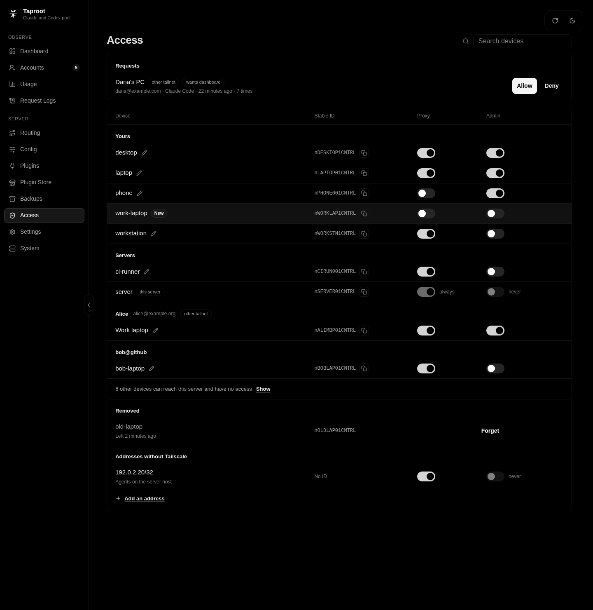

**Addresses without Tailscale**, at the end of the page, lets a caller outside the tailnet use the proxy. Such a caller has no Tailscale identity, so it can never be an admin. Add single addresses (`/32`) only, because every host in a wider range reaches the proxy.

Loopback callers are admins. Do not put `tailscale serve`, `tailscale funnel`, a reverse proxy, or an SSH tunnel in front of taproot on the same host. They usually connect from loopback, so every caller they forward becomes an admin. If you lose every admin device, remove the `admin: true` entries from `taproot.yaml` and restart taproot. It logs a new setup code.

The "Security model" section of [`internal/taproot/DESIGN.md`](internal/taproot/DESIGN.md#security-model) describes who reaches what and how the guard refuses requests from other websites.

### Check the deployment

Run these checks after you install taproot and after every change to how it is published. Stop if a result differs.

1. From a device with Admin, open `http://<server>:8317/taproot/api/v1/me`. It must show `"via":"tailnet"` and `"admin":true`. If it shows `"via":"loopback"`, something rewrites caller addresses, and every caller is an admin.
2. From a device without Admin, the same URL must return 403 with the code `not_admin`.
3. On the server host, `curl "http://$(tailscale ip -4):8317/taproot/api/v1/me"` must return 403.

## Configuration

Taproot reads two files from the data directory:

- `config.yaml` is CLIProxyAPI's configuration. On the first start, taproot writes [`examples/taproot/config.yaml`](examples/taproot/config.yaml), the minimal configuration for taproot, with `oauth.auth-dir` moved beside the file. CLIProxyAPI ignores keys it does not know, so a taproot setting in `config.yaml` has no effect.
- `taproot.yaml` holds taproot's own settings. Taproot reads it strictly, so an unknown key stops startup with the key's name. The dashboard's **Access** and **Settings** pages edit it in place. [`examples/taproot/taproot.yaml`](examples/taproot/taproot.yaml) shows a filled-in file.

Taproot never replaces an existing file. If `config.yaml` exists and `taproot.yaml` does not, taproot stops and names the missing file.

### taproot.yaml

Every key is optional. Sizes accept a number of bytes or a value such as `512MiB` or `20GB`, and both suffixes mean powers of 1024.

| Key | Default | Meaning |
| --- | --- | --- |
| `data-dir` | `taproot` | Directory for the database, request logs, and backups. A relative path is relative to `config.yaml`. |
| `store.path` | `taproot.db` | The SQLite database. A relative path is relative to `data-dir`. |
| `access.devices` | empty | Each device's permissions: `id` (its stable ID), `name` (a label taproot keeps in step with the tailnet), `proxy`, and `admin`. A device that is not listed has neither. |
| `access.addresses` | empty | Addresses outside Tailscale that may use the proxy: `cidr` and an optional `note`. |
| `access.extra-hosts` | empty | More `Host` names the server answers to. |
| `access.tailscale-socket` | `/var/run/tailscale/tailscaled.sock` | The `tailscaled` LocalAPI socket. |
| `access.cache-ttl` | `1m` | How long taproot caches the answer to "which device is this address". |
| `access.enabled` | `true` | Keep it `true`. `false` opens the proxy to every caller and limits the dashboard and APIs to loopback. |
| `ingest.poll-interval` | `15m` | How often taproot polls the quota of idle accounts. `0` turns polling off. |
| `request-logs.max-days` | `14` | Delete request logs older than this many days. A negative value keeps them forever. |
| `request-logs.max-bytes` | `20GiB` | Delete the oldest request logs when the directory passes this size. A negative value removes the limit. |
| `request-logs.exclude-paths` | empty | Paths never stored, such as `/v1/models` or `HEAD /api/*`. |
| `request-logs.keep-unrouted-404` | `false` | Store 404 responses for paths the proxy does not serve. |
| `request-logs.queue-bytes` | `256MiB` | Memory for records that wait to be written. Past it, bodies are dropped and the record says so. |
| `request-logs.segment-max-bytes` | `128MiB` | Stored size at which a segment file closes. |
| `request-logs.open-max-bytes` | `4GiB` | Total raw size of open segments. Past it, the largest one closes early. |
| `request-logs.seal-idle` | `15m` | Close a session's segment after this long without requests. |
| `request-logs.seal-age` | `6h` | Close a segment this long after it opened. |
| `backups.daily-at` | `00:00` | Time of the daily backup, as `HH:MM` in the `TZ` zone, or `off`. |
| `backups.keep` | `14` | Backups kept of each kind: scheduled, manual, and pre-restore. |
| `alerts.discord-webhook` | empty | Discord webhook URL. It is a secret. |
| `alerts.enabled` | `true` | Turns alerts off without removing the webhook. |

`access.allow-logins`, `access.admin-nodes`, and `access.trusted-cidrs` from v0.1.0 stop startup with a message that names their replacement, `access.devices` or `access.addresses`.

### Environment variables

| Variable | Meaning |
| --- | --- |
| `TZ` | Time zone of the backup schedule, such as `Etc/UTC` or `Europe/Berlin`. The image sets none. |
| `TAPROOT_CONFIG` | Path of `taproot.yaml`, when it is not beside `config.yaml`. |

### config.yaml

[`config.example.yaml`](config.example.yaml) documents every CLIProxyAPI key, such as `routing`, `requests`, and the per-provider `upstream` settings. You need it only for advanced settings. Taproot replaces or ignores some of them:

- Keep `access.api-keys` empty. Taproot admits callers by Tailscale identity, and clients send a placeholder key.
- Leave `management.secret-key`, `management.allow-remote`, and the control-panel keys as the minimal config sets them. Taproot authorizes the management API itself and serves its own dashboard.
- The access guard ignores forwarding headers, so `server.trusted-proxies` does not change who reaches taproot.
- `observability.logs.request-log` turns taproot's request logs on and off. The dashboard's **Record requests** switch writes it.
- Taproot refuses to start in CLIProxyAPI's Home mode.
- Do not use CLIProxyAPI's Postgres, git, or object stores (the `PGSTORE_*`, `GITSTORE_*`, and `OBJECTSTORE_*` variables). Taproot is tested only with local files, and a backup captures only the local copies.

## Try it without Tailscale

The demo seeds a temporary data directory with synthetic accounts, 30 days of usage, request logs, and backups, and serves the real server with a fake `tailscaled` on `http://127.0.0.1:8399`. Nothing leaves the machine. It needs Go and Bun and a clone of this repository:

```sh
bash scripts/taproot/build-web.sh
bash internal/taproot/demo/run.sh
```

`build-web.sh` rewrites `internal/taproot/web/dist/index.html`. Run `git checkout internal/taproot/web/dist/index.html` afterwards to restore it. [CONTRIBUTING.md](CONTRIBUTING.md#demo-data-and-screenshots) describes the demo's options.

## Stability and upgrades

Taproot is not at version 1.0. A minor release can rename a `taproot.yaml` key or change the dashboard, and a patch release fixes bugs. [docs/stability.md](docs/stability.md) says what a release can change and how to upgrade and roll back.

Data from v0.1.0 is not carried forward. To move from v0.1.0, start the new release on a new data directory with your `config.yaml`, `taproot.yaml`, and `auths/`. In `taproot.yaml`, replace `access.allow-logins`, `access.admin-nodes`, and `access.trusted-cidrs` with an `access.devices` list and `access.addresses`, as [`examples/taproot/taproot.yaml`](examples/taproot/taproot.yaml) shows. Taproot refuses to start until you do.

## The dashboard

The dashboard is served at `/` on the proxy port. It has these pages:

- **Dashboard:** recent requests and their success rate, the number of credentials and models, and the server's version and runtime settings.
- **Accounts:** pool charts, the quota ledger, credentials, and sign-in.
- **Usage:** cost, tokens, latency, and failures, by account, model, session, and device.
- **Request Logs:** search and view stored requests. The application log is a tab here.
- **Backups:** create, download, and restore backups.
- **Access:** every device on the tailnet with its Proxy and Admin switches, and the addresses that reach the proxy without Tailscale.
- **Settings:** request logs and their limits, the backup schedule, quota polling, and Discord alerts.
- **Routing, Config, Plugins, Plugin Store, and System:** CLIProxyAPI's settings and plugins.

Account emails are hidden until you select **Show emails**. All screenshots use synthetic data from the demo. Select an image for the full size.

| | |
| --- | --- |
| [](docs/screenshots/accounts.png)<br>**Accounts:** pool chart and quota ledger | [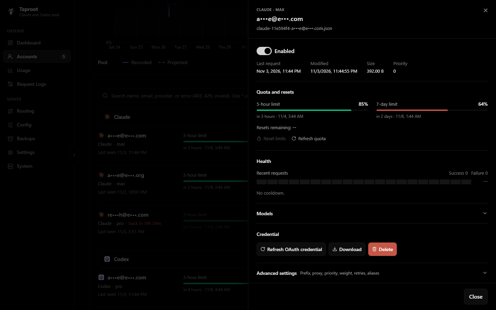](docs/screenshots/accounts-manage.png)<br>**Manage:** quota, resets, health, credential, and advanced settings for one account |
| [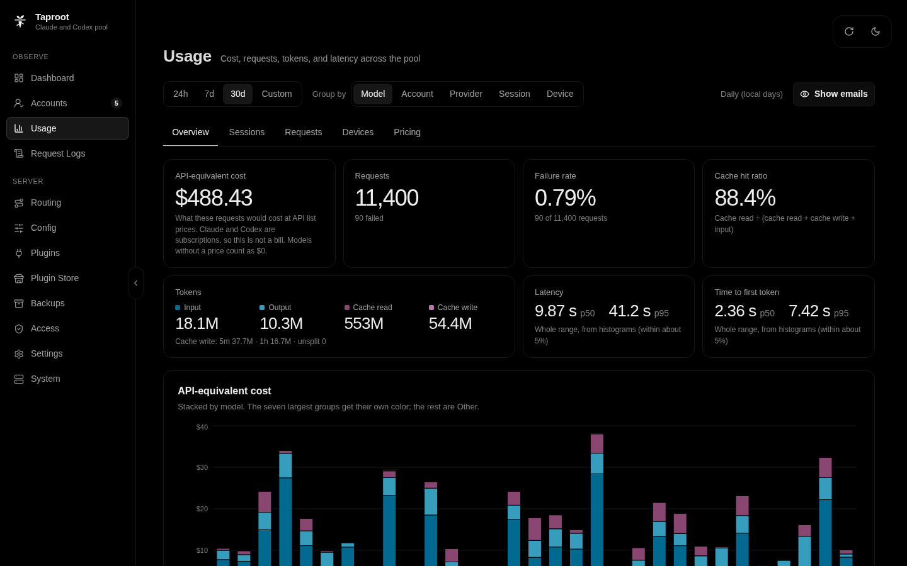](docs/screenshots/usage-overview.png)<br>**Usage:** cost, tokens, cache hits, and latency | [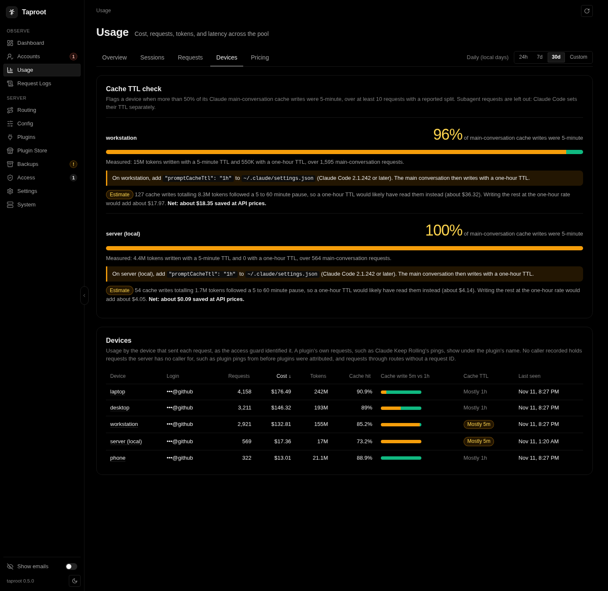](docs/screenshots/usage-devices.png)<br>**Devices:** usage per tailnet device and the cache TTL check |
| [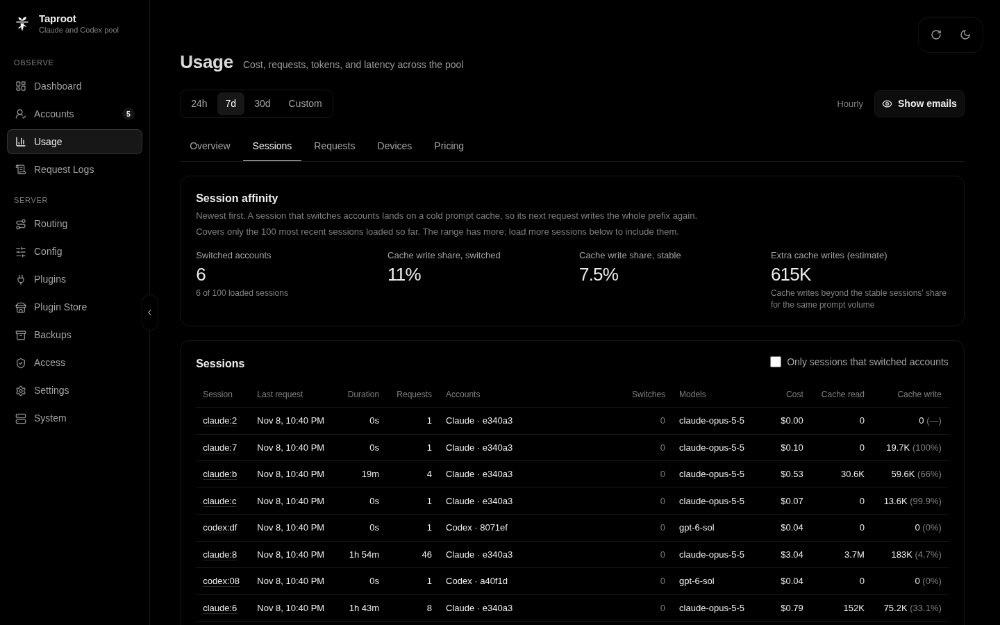](docs/screenshots/usage-sessions.png)<br>**Sessions:** session affinity and account switches | [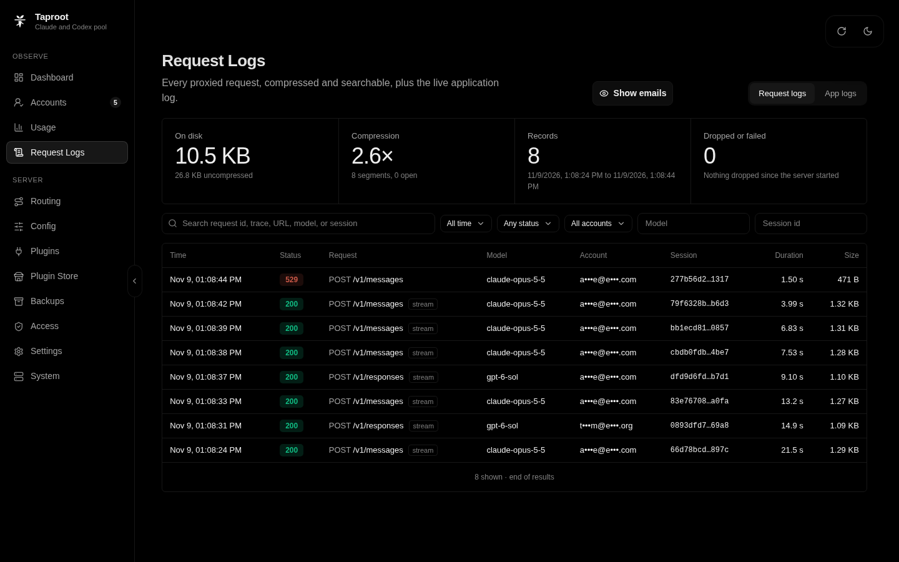](docs/screenshots/request-logs.png)<br>**Request Logs:** every proxied request, compressed and searchable |
| [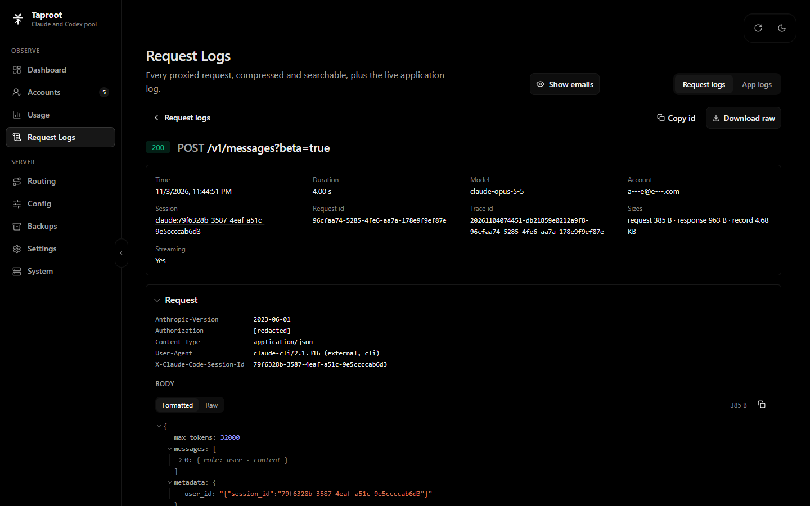](docs/screenshots/request-log-detail.png)<br>**Request detail:** headers with credentials redacted, and the body | [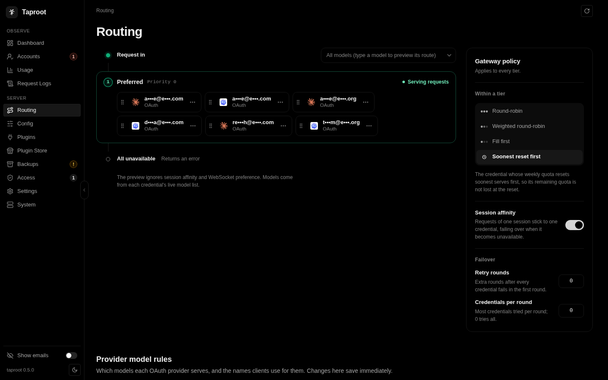](docs/screenshots/routing.png)<br>**Routing:** soonest-reset-first and session affinity |
| [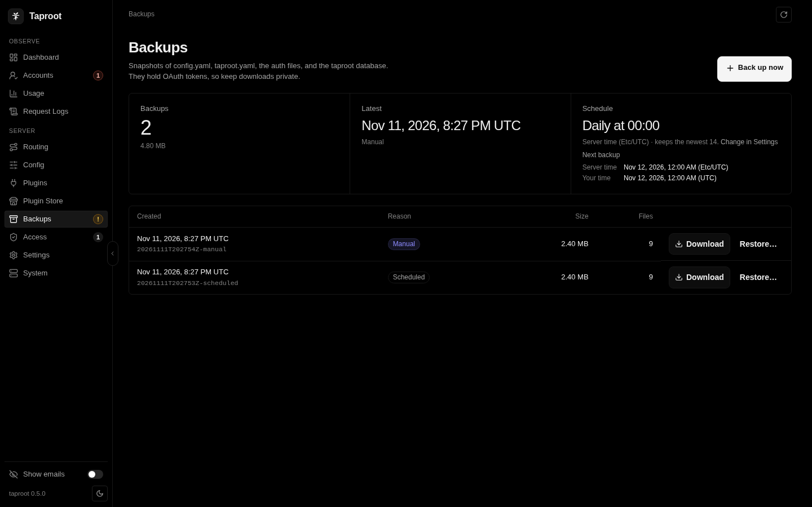](docs/screenshots/backups.png)<br>**Backups:** scheduled and manual backups, with the next run in server time and your time | [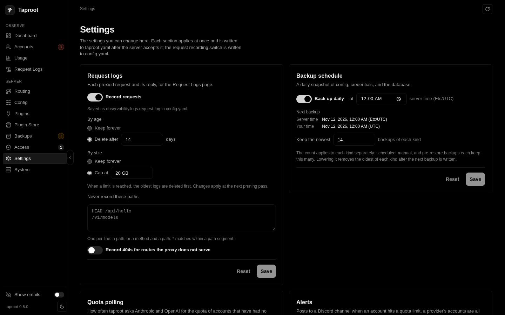](docs/screenshots/settings.png)<br>**Settings:** request logs and the backup schedule |
| [](docs/screenshots/access.png)<br>**Access:** every tailnet device by owner, with its Proxy and Admin switches | [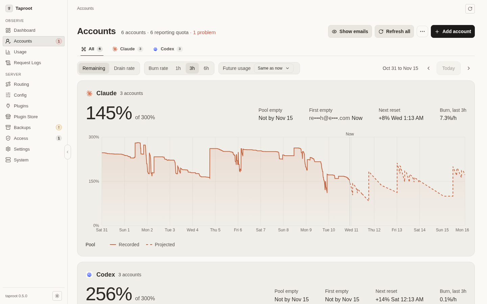](docs/screenshots/accounts-light.png)<br>**Light theme** |

## Terms of service

This section is a warning. It is not legal advice.

Taproot is for personal use of your own subscription accounts, at your own risk. It signs in to those accounts with OAuth, stores the tokens, and sends requests from every client on your tailnet through them. The providers' terms address this directly:

- Anthropic's [Consumer Terms](https://www.anthropic.com/legal/consumer-terms) say: "You may not share your Account login information, Anthropic API key, or Account credentials with anyone else." They also forbid access "through automated or non-human means" except with an API key or where Anthropic expressly permits it.
- Anthropic's [Claude Code legal and compliance page](https://code.claude.com/docs/en/legal-and-compliance) says: "Anthropic does not permit third-party developers to offer Claude.ai login into their own applications, or to route requests through Free, Pro, Max, or Ultra plan credentials on behalf of their users." It also says that advertised plan limits "assume ordinary, individual usage".
- Anthropic's [Usage Policy](https://www.anthropic.com/legal/aup) lists "services that route requests through consumer subscriptions or misrepresent the product or client being used" under unauthorized access.
- OpenAI's [Terms of Use](https://openai.com/policies/terms-of-use/), effective January 1, 2026, say under "Registration and access": "You may not share your account credentials or make your account available to anyone else and are responsible for all activities that occur under your account." Under "Using our Services", one of the things you may not do is: "Automatically or programmatically extract data or Output". The terms do not mention Codex.

CLIProxyAPI, by default, presents clients other than Claude Code as the Claude Code CLI on Claude accounts. `upstream.claude.disable-claude-cloak-mode` in `config.yaml` turns that off.

A provider can suspend or close an account that breaks its terms. Use taproot only with accounts you own, for your own use. Read each provider's current terms before you add an account, and decide for yourself whether your use is allowed.

## Security

Taproot stores OAuth refresh tokens, and its request logs hold every prompt and response. [SECURITY.md](SECURITY.md) lists the rules for running it safely and how to report a vulnerability privately. The short version:

- Publish the port on the host's Tailscale address only, never on `0.0.0.0`, a LAN address, or `127.0.0.1`.
- Put nothing in front of taproot on the same host, and never set `access.enabled: false`.
- Give Admin only to the devices you use the dashboard from.
- Run [Check the deployment](#check-the-deployment) after every change.

## Contributing

[CONTRIBUTING.md](CONTRIBUTING.md) explains what belongs in taproot, how the fork stays mergeable with CLIProxyAPI, and the checks to run before you send a change. To build from source, you need Go, Bun, and, for the request-log codec, a Rust toolchain. CONTRIBUTING.md shows the build the image uses. [`internal/taproot/DESIGN.md`](internal/taproot/DESIGN.md) describes how taproot is built and why.

## License

Taproot is released under the [MIT License](LICENSE), the license of CLIProxyAPI. The dashboard in `web/` keeps the Management Center's [MIT License](web/LICENSE). [THIRD_PARTY_NOTICES.md](THIRD_PARTY_NOTICES.md) lists the licenses of the Go modules, Rust crates, and npm packages taproot ships, and of the Go and Rust standard libraries.

The request-log codec links Rust crates under the GNU LGPL v3. The notices say where their source is and how to rebuild taproot with a modified copy, and [licenses/](licenses) holds the LGPL and GPL texts. The image ships these files in `/taproot/`, and each release tarball ships them beside the binary.

- [CLIProxyAPI](https://github.com/router-for-me/CLIProxyAPI): Copyright (c) Luis Pater and Router-For.ME.
- [CLIProxyAPI Management Center](https://github.com/router-for-me/Cli-Proxy-API-Management-Center): Copyright (c) Router-For.ME.
- Most provider icons come from [Lobe Icons](https://github.com/lobehub/lobe-icons).

## Trademarks

Taproot is not affiliated with Router-For.ME, Anthropic, OpenAI, or Tailscale. Claude, Codex, OpenAI, Tailscale, and the other provider names and logos are trademarks of their owners.
