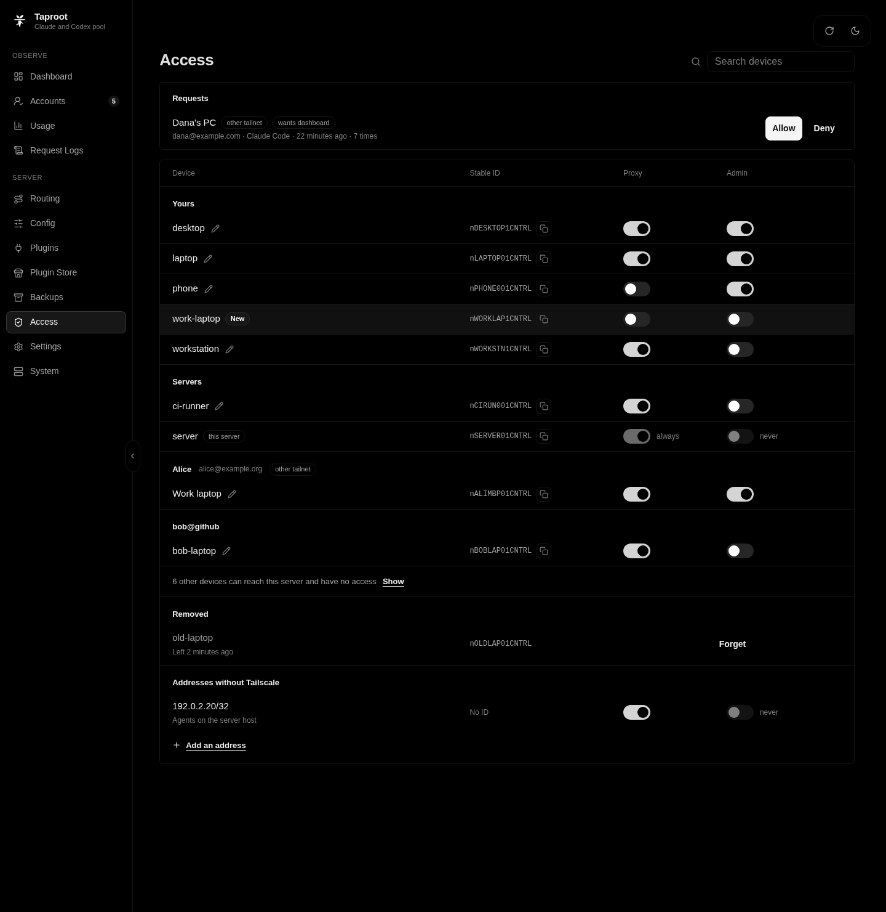

# Access

Taproot decides what each caller may do by its Tailscale identity. You manage that on the dashboard's **Access** page.

## Permissions

Every tailnet device has two permissions:

- **Proxy** lets the device send model requests, from Claude Code or Codex.
- **Admin** lets the device open the dashboard and change settings.

New devices start with neither. The server's own node always has Proxy and never Admin. Permissions belong to the device's Tailscale stable ID, so a device that takes another device's name gets nothing.

Addresses outside Tailscale, listed under **Addresses** (`access.addresses` in `taproot.yaml`), get Proxy only. Add single addresses (`/32`) only, because every host in a wider range reaches the proxy.

## The Access page

The page lists devices in these groups:

- **Requests:** devices that tried taproot without permission.
- **Yours:** your own devices.
- **Servers:** tagged devices, which belong to a tag instead of a person.
- Other people with devices you allowed, one group each.
- A folded line for every other device that can reach the server but has no access.
- **Removed:** devices no longer on the tailnet. Taproot forgets them after 24 hours; select **Forget** to remove one sooner.
- **Addresses:** callers outside Tailscale.

To rename a device, select the pencil next to its name, then **Save**. Only a device with Proxy or Admin keeps a name. Taproot stores it as `label` in `taproot.yaml`, and a rename in Tailscale does not change it.

## Allow a new device

A device without permission becomes a request when it tries taproot.

- From a browser on that device, open `http://<server>:8317/`, name the device, and select **Request access**.
- From Claude Code or Codex, the refused request creates the request itself. The error tells the person to open taproot's address in a browser on that device. Do not run `/login`.

On the Access page, allow the request with Proxy, Admin, or both, and a name, or deny it. **Allow** starts with Proxy on. After you allow a device, its later refusals stay quiet; it can still ask again from its browser, for example with **Request dashboard access** when it has Proxy but not Admin. If you set up [Discord alerts](configuration.md#taprootyaml), taproot sends an alert for each new request.

## Allow a device from another tailnet

You can share the taproot server with another Tailscale account, such as a work laptop in a separate tailnet. Tailscale hides the names of that account's devices, so they show as `<owner>'s device ·abcd` until you name them. You can switch on Proxy for such a device directly. Admin needs the device to send a request, which you then allow.

Claim a new server from a device in the server's own tailnet.

## Recover when every admin device is lost

1. Stop taproot.
2. Remove every `admin: true` from `access.devices` in `taproot.yaml`.
3. Start taproot. It logs a new setup code, as when you first [claimed the server](../README.md#quick-start).

## Check the deployment

Run these checks after you install taproot and after every change to how you publish it. If a result differs, stop taproot and fix the setup.

1. From a device with Admin, open `http://<server>:8317/taproot/api/v1/me`. It must show `"via":"tailnet"` and `"admin":true`. If it shows `"via":"loopback"`, something rewrites caller addresses, and every caller is an admin. See [Troubleshooting](troubleshooting.md#taproot-refuses-every-caller-or-me-shows-loopback).
2. From a device without Admin, the same URL must return 403 with the code `not_admin`.
3. On the server host, `curl "http://$(tailscale ip -4):8317/taproot/api/v1/me"` must return 403.

Put nothing in front of taproot on the same host (see [Troubleshooting](troubleshooting.md#taproot-refuses-every-caller-or-me-shows-loopback)). [SECURITY.md](../SECURITY.md) lists the other rules, and the "Security model" section of [`internal/taproot/DESIGN.md`](../internal/taproot/DESIGN.md#security-model) describes the design.
