# Dashboard

Taproot serves its dashboard at `/` on the proxy port, such as `http://<server>:8317/`. Only devices with Admin can open it. See [Access](access.md).

## The home page

The home page answers "is everything OK, and what needs me?" before anything else. The main column follows a window you choose. The right rail, **Needs you** and **Pools**, always shows the server right now.

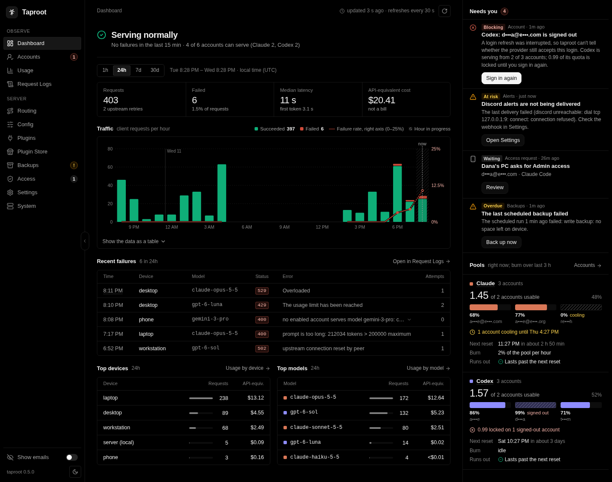

### The verdict says whether the server is serving

The verdict judges the last 15 minutes and the accounts that can serve right now. It ignores the window. Client requests count once, however many accounts they tried. A request the client abandoned is not a failure, and fewer than 20 requests are too few to judge.

| Verdict | When |
| --- | --- |
| **Serving normally** | Neither of the rows below applies. The detail line says how many accounts can serve, per provider. |
| **Degraded** | At least 5% of at least 20 client requests failed in the last 15 minutes, or a provider that had traffic in the last hour has only one usable account left. A provider with only one enabled account is not degraded by that. |
| **Down** | At least 50% of at least 20 client requests failed in the last 15 minutes, or a provider that had traffic in the last hour has no account that can serve. |

A degraded or down verdict has **See failures**, which opens Request Logs on the errors of the last 15 minutes. The header shows when the page last loaded and that it refreshes every 30 seconds.

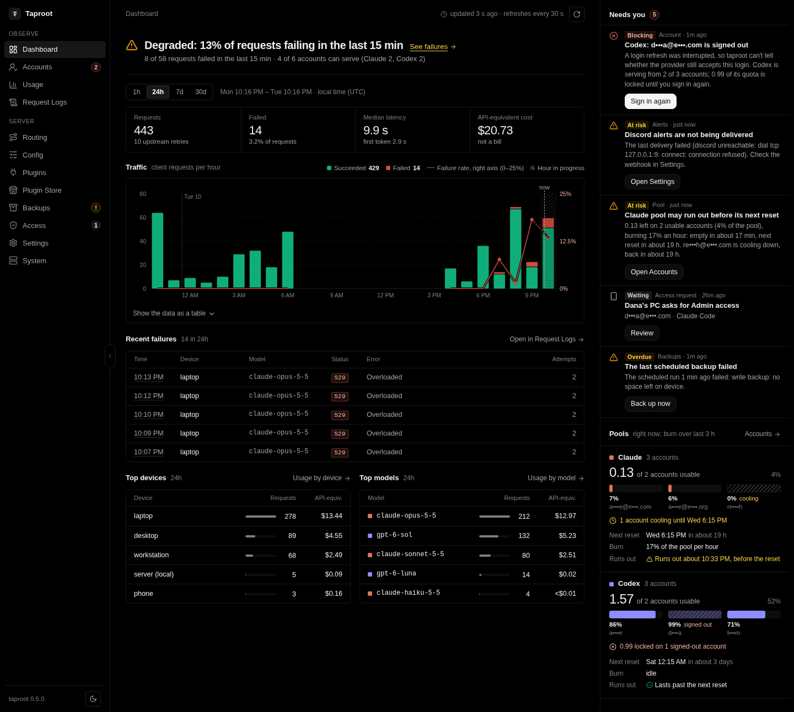

### Needs you lists each problem with one fix

Each item has a severity tag (**Blocking**, **At risk**, **Waiting**, or **Overdue**), a title, a detail line, how long it has waited, and one button. The most severe items come first, then the oldest. With nothing to do, the rail says **Nothing needs you**.

| Problem | Button |
| --- | --- |
| An account is signed out, or its login can no longer refresh. | **Sign in again** opens Accounts and starts that provider's sign-in. |
| An account is disabled while nothing else serves its provider and clients still ask for it. | **Enable** turns it on in place. |
| A pool is projected to run out before its next reset, or has under 15% left. If every enabled account is cooling, it is Blocking: "<provider> has no usable account". Cooling accounts are named here, not listed on their own. | **Open Accounts** opens that provider's tab. |
| A device asks for access. | **Review** opens Access at that device's request. |
| The newest backup is over 26 hours old, or the last scheduled backup failed. | **Back up now** runs a backup in place. |
| Discord alerts fail to deliver. | **Open Settings** opens the alerts settings. |
| Taproot can't reach `tailscaled`. | **Troubleshooting** opens the [troubleshooting guide](troubleshooting.md#every-tailnet-device-is-refused-after-tailscaled-restarts-or-updates). |
| Taproot can't read its access requests or backups. | **Open the app log** opens Request Logs' app-log tab. When file logging is off, that tab is empty, so the item says to read the server's own output, or `journalctl -u taproot`, instead. |

**Enable** and **Back up now** say how they went. A fix that clears its item leaves its result in the item's place.

### Pools show what each provider can serve now

Each provider's name opens Accounts on that provider's tab. Each provider has one bar per account, labelled with the part of its email before the @ and the share of quota left. Cooling, signed-out, and disabled accounts are hatched. The headline counts usable accounts only, such as "1.45 of 2 accounts usable". Notes under the bars give the quota locked on signed-out and disabled accounts, and the quota on cooling accounts and when they are back; both show when both apply. Below that are the next reset, the burn over the last 3 hours as a share of the pool per hour, and when the pool runs out.

### The window sets the numbers, the chart, and the lists

Choose 1 hour, 24 hours, 7 days, or 30 days. The default is 24 hours, and this browser remembers your choice. The caption shows the range and your time zone. A server upgraded from taproot 0.4 counts client requests only from the upgrade on, so when the window starts before the first one the caption says "Counting since" that time instead, and "No client requests recorded yet" until the first. The window sets these sections:

- **Tiles:** client requests with upstream retries, failed requests and their share, median latency with median time to first token, and the API-equivalent cost, which names the models without a price.
- **Traffic chart:** succeeded and failed client requests per 5 minutes, hour, or day, with the failure rate on a right axis. It marks now and hatches the bucket in progress. Hover, tap, or use the arrow keys to read a bar. **Show the data as a table** shows the same numbers as a table.
- **Recent failures:** the last five failed requests in the window, with time, device, model, status, error, and attempts. Each row opens its request in Request Logs, and **Open in Request Logs** opens Request Logs on the errors of the window. A failure without a stored log has nothing to open, so when its row cuts the device, model, or error, the row opens in place to show them in full.
- **Top devices and top models:** requests and API-equivalent cost in the window. **Usage by device** and **Usage by model** open Usage.

The Dashboard counts client requests, which taproot records from 0.5.0 on. On a server upgraded from 0.4, the tiles, chart, and lists start empty and fill with new requests. Usage keeps the earlier history.

### A new server shows a setup checklist

Until the server has an account and has served its first client request, a three-step checklist replaces the window. Each step ticks itself off:

1. **Add an account** is done once the server has an account.
2. **Point a client at taproot** has Claude Code and Codex snippets with the address you opened the dashboard at. It is done when the first client request arrives. If you opened the dashboard on the server itself, or through a proxy such as `tailscale serve`, the step says which address other devices need.
3. **Approve devices** is done once a device other than the server has Admin, or while access control is off (`access.enabled: false`).

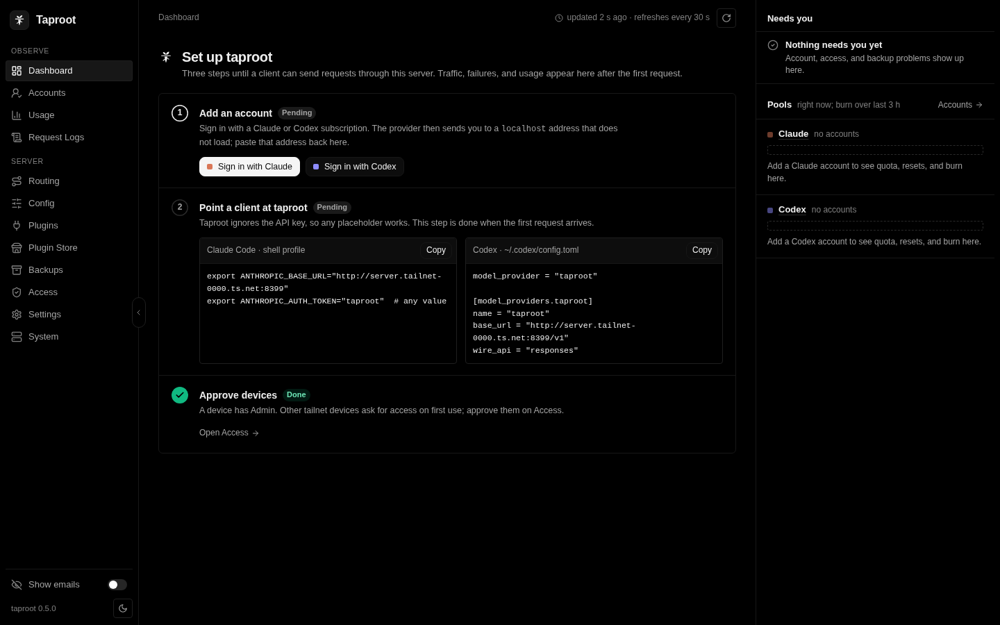

A server upgraded from 0.4 has usage history, so it shows the Dashboard rather than the checklist.

### The page keeps its last numbers when a read fails

The page rereads everything every 30 seconds while the tab is visible. When a read fails, the section keeps its last numbers, marks them stale, and offers **Retry**. When the server can't be reached at all, the page says so once at the top, with one **Retry**, and keeps every section's last numbers. A section that had nothing to keep says "Not loaded".

### On a phone the page reads top to bottom

The order is the verdict, **Needs you**, **Pools**, then the window and its numbers. On first run the checklist comes first. Each part sits on its own raised card. On a phone held upright or sideways, text is a step larger than on a desktop. On a touch screen, every button and link is at least 44 pixels tall. Long device and model names wrap rather than cut off. Tap a bar of the chart to read it, and tap it again to close it.

**Needs you** is a compact list on a phone. Each row shows the severity, the title, and a short fix button, such as **Sign in** or **Back up**. Tap a title to open or close its detail in place. The first row starts open. On a screen narrower than 360 pixels, the button moves under the title. Each pool shows its next reset, its burn over the last 3 hours, and when it runs out as three cells under the bars. Tablets and desktops keep the layout above.

### Badges show what needs you on every page

The items in **Needs you** also put badges on **Accounts**, **Access**, and **Backups** in the sidebar. A badge counts the area's items and takes the color of its most severe one. **Backups** shows "!". While anything needs you, the tab title starts with a dot (●), and on a phone the menu button shows the count.

## Other pages

- **Accounts:** pool charts, the quota ledger, credentials, and sign-in. See [Accounts](accounts.md). One row above the charts holds the provider, what the chart shows (**Remaining** or **Drain rate**), **Projection** (the burn window of 1, 3, or 6 hours and the future usage it assumes), and the dates. On a phone, the provider tabs stay, and **View** opens a sheet with the burn window, future usage, and dates. Its label sums up your choices. **Remaining** and **Drain rate** stay beside **View**, except on a screen narrower than 375 pixels, where they move into the sheet. **Refresh all** is in the **⋯** menu on a phone.
- **Usage:** cost, tokens, latency, and failures, by account, model, session, and device. The views and the range share one row. **Group by** on the cost chart groups the Overview by model, account, provider, session, or device. On a phone, a menu chooses the view, and **Options** opens a sheet with the range and the grouping.
- **Request Logs:** search and view stored requests. The application log is a tab here.
- **Backups:** create, download, and restore backups.
- **Access:** device requests, every tailnet device with its Proxy and Admin switches, and the addresses that reach the proxy without Tailscale.
- **Settings:** request logs and their limits, the backup schedule, quota polling, and Discord alerts.
- **Routing, Config, Plugins, Plugin Store, and System:** CLIProxyAPI's settings and plugins. System also counts the models the proxy serves.

Account emails stay hidden on every page until you turn on **Show emails** at the bottom of the sidebar (an eye button when the sidebar is collapsed). The switch covers every page, including the owners' logins on Access, and turns itself off again whenever you reload or open the dashboard.

## Screenshots

The screenshots use synthetic data from the demo server that [CONTRIBUTING.md](../CONTRIBUTING.md#demo-data-and-screenshots) describes. Each row shows a page on a desktop and on a phone. Select an image to see it at full size.

| Page | Desktop | Phone |
| --- | --- | --- |
| **Dashboard:** the verdict, Needs you, Pools, and the 24-hour window |  | [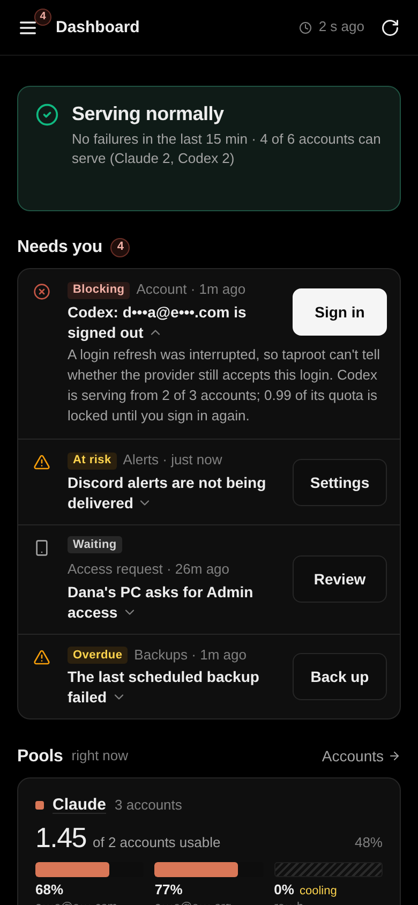](screenshots/dashboard-mobile.png) |
| **Dashboard, degraded:** failing requests and a pool that runs out before its reset |  | [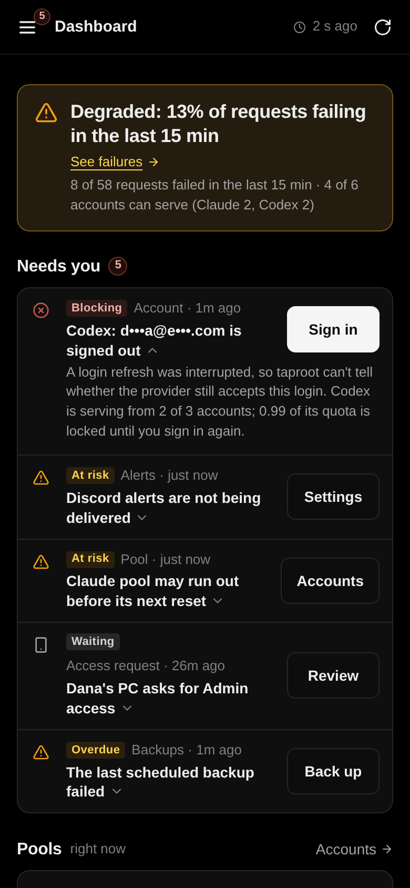](screenshots/dashboard-degraded-mobile.png) |
| **Dashboard, first run:** the setup checklist |  | [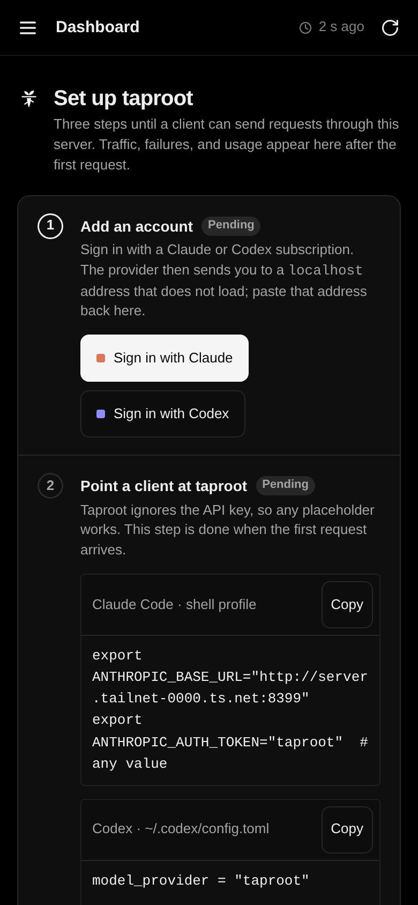](screenshots/dashboard-first-run-mobile.png) |
| **Accounts:** pool chart and quota ledger | [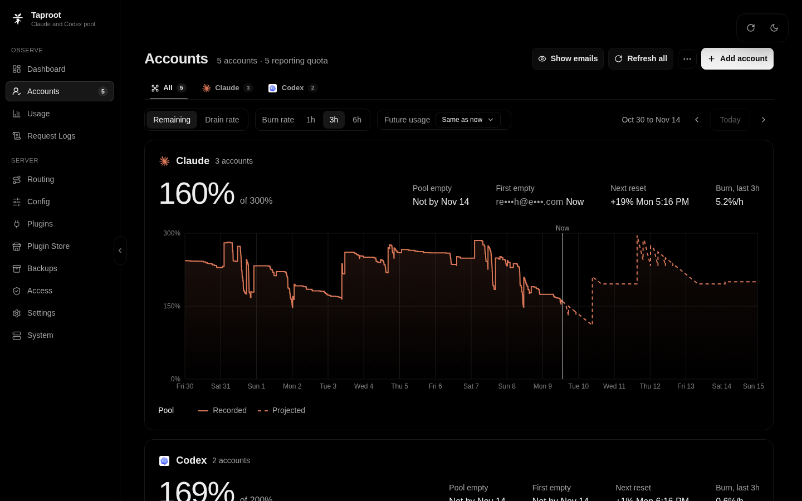](screenshots/accounts.png) |  |
| **Manage:** quota, resets, health, credential, and advanced settings for one account | [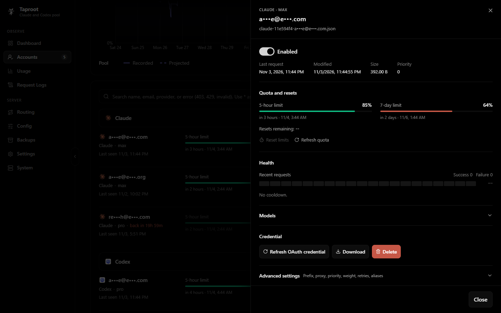](screenshots/accounts-manage.png) |  |
| **Usage:** cost, tokens, cache hits, and latency | [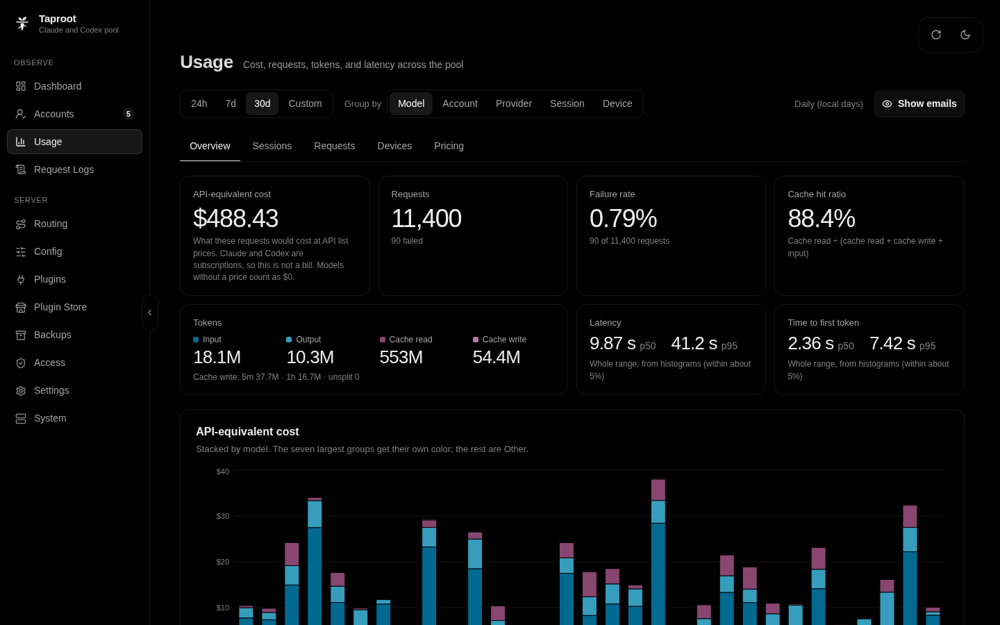](screenshots/usage-overview.png) |  |
| **Devices:** usage per tailnet device and the cache TTL check | [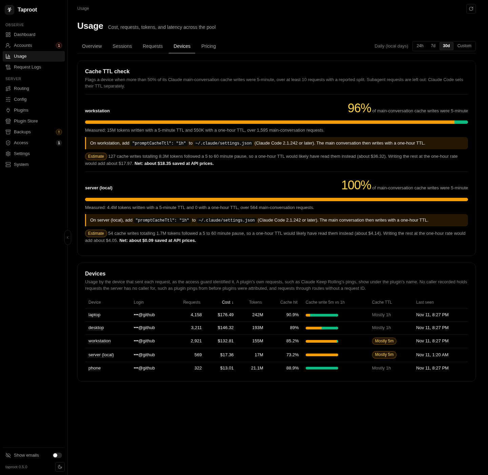](screenshots/usage-devices.png) |  |
| **Sessions:** session affinity and account switches | [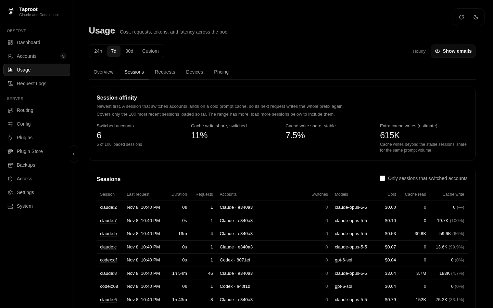](screenshots/usage-sessions.png) |  |
| **Request Logs:** every proxied request, compressed and searchable | [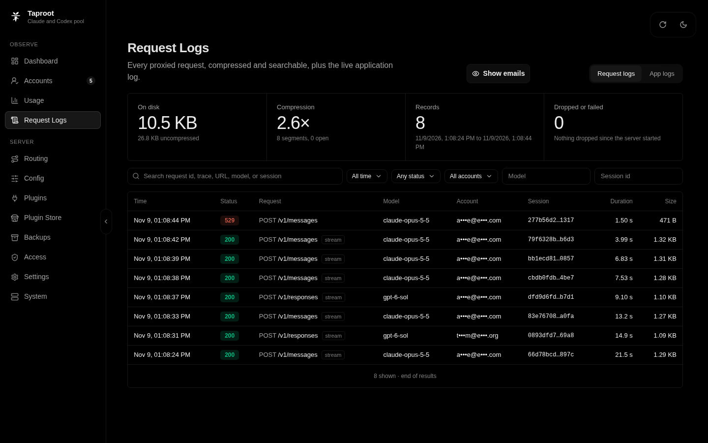](screenshots/request-logs.png) |  |
| **Request detail:** headers with credentials redacted, and the body | [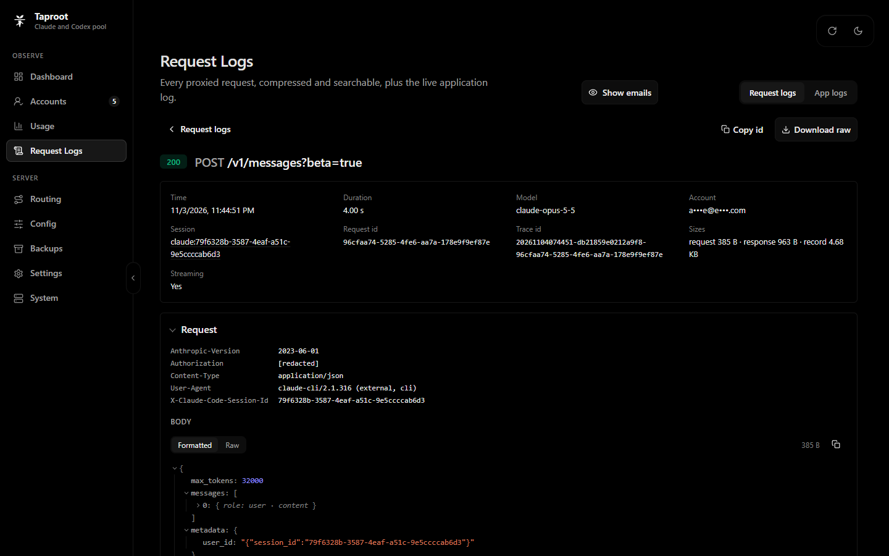](screenshots/request-log-detail.png) |  |
| **Routing:** soonest-reset-first and session affinity | [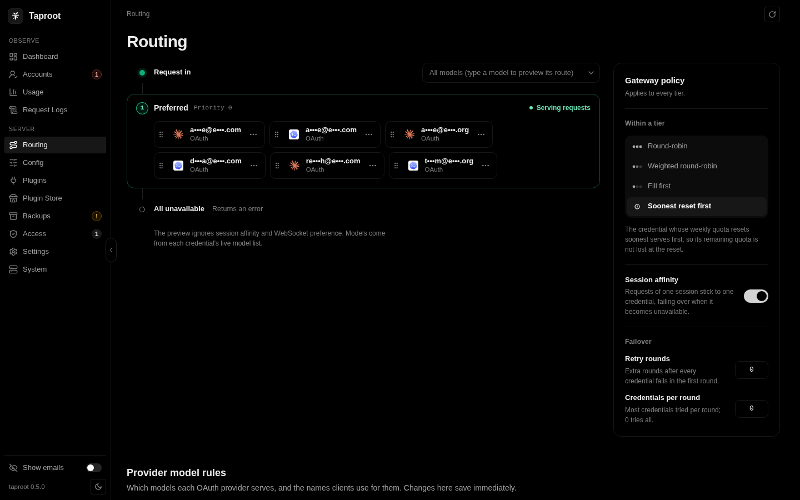](screenshots/routing.png) |  |
| **Backups:** scheduled and manual backups, with the next run in server time and your time | [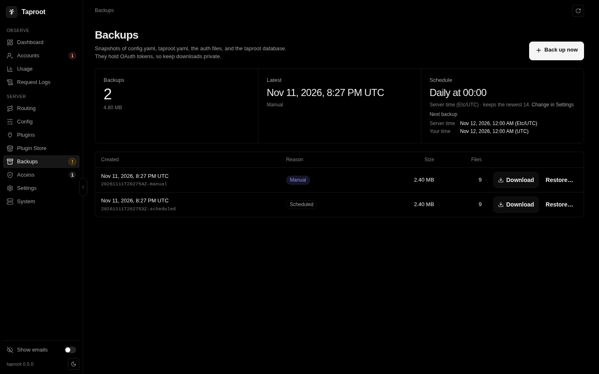](screenshots/backups.png) |  |
| **Access:** tailnet devices and requests, with their Proxy and Admin switches | [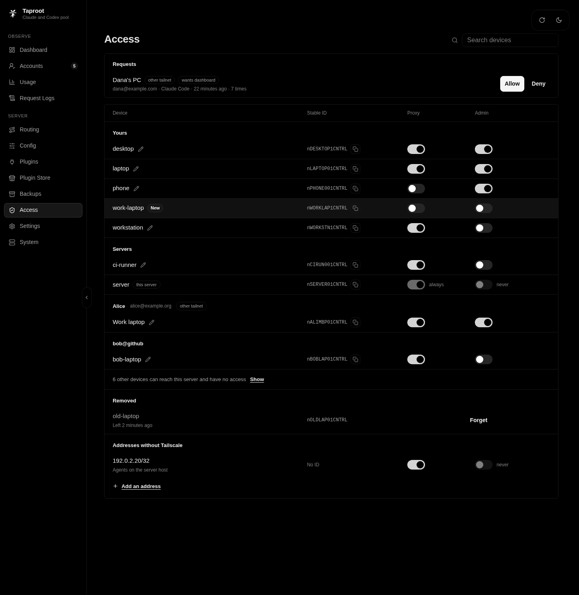](screenshots/access.png) |  |
| **Settings:** request logs and the backup schedule | [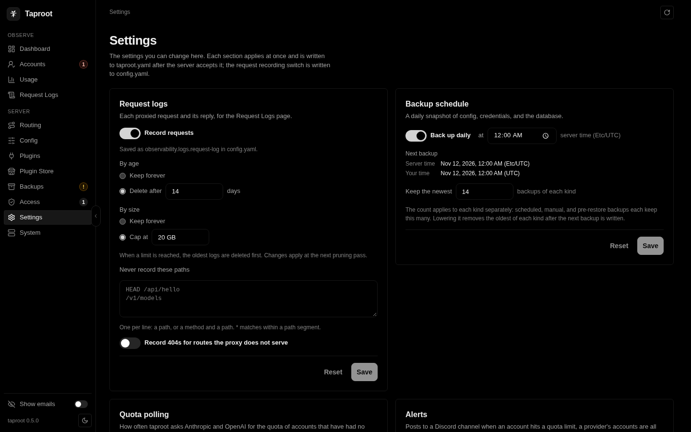](screenshots/settings.png) |  |
| **Light theme:** the Accounts page in the light theme | [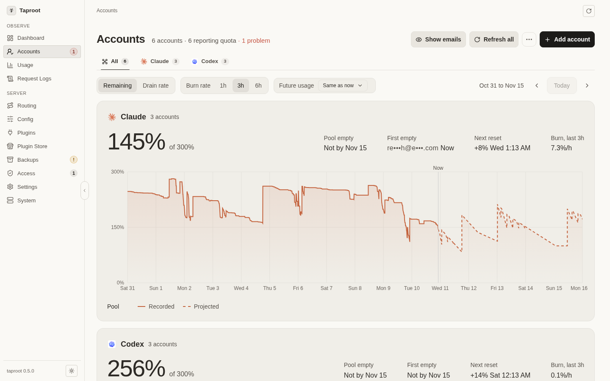](screenshots/accounts-light.png) |  |
