# Dashboard

Taproot serves its dashboard at `/` on the proxy port, such as `http://<server>:8317/`. Only devices with Admin can open it. See [Access](access.md).

## Pages

- **Dashboard:** recent requests and their success rate, the number of credentials and models, and the server's version and runtime settings.
- **Accounts:** pool charts, the quota ledger, credentials, and sign-in. See [Accounts](accounts.md).
- **Usage:** cost, tokens, latency, and failures, by account, model, session, and device.
- **Request Logs:** search and view stored requests. The application log is a tab here.
- **Backups:** create, download, and restore backups.
- **Access:** device requests, every tailnet device with its Proxy and Admin switches, and the addresses that reach the proxy without Tailscale.
- **Settings:** request logs and their limits, the backup schedule, quota polling, and Discord alerts.
- **Routing, Config, Plugins, Plugin Store, and System:** CLIProxyAPI's settings and plugins.

Account emails stay hidden until you select **Show emails**.

## Screenshots

The screenshots use synthetic data from the demo server that [CONTRIBUTING.md](../CONTRIBUTING.md#demo-data-and-screenshots) describes. Each row shows a page on a desktop and on a phone. Select an image to see it at full size.

| Page | Desktop | Phone |
| --- | --- | --- |
| **Accounts:** pool chart and quota ledger |  | [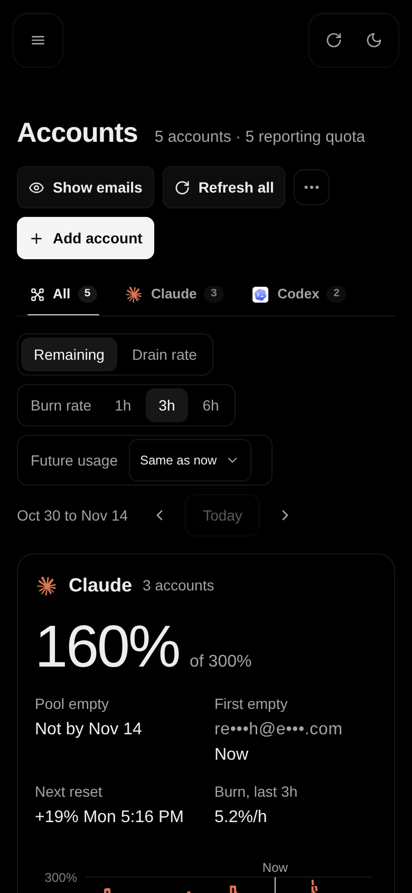](screenshots/accounts-mobile.png) |
| **Manage:** quota, resets, health, credential, and advanced settings for one account |  | [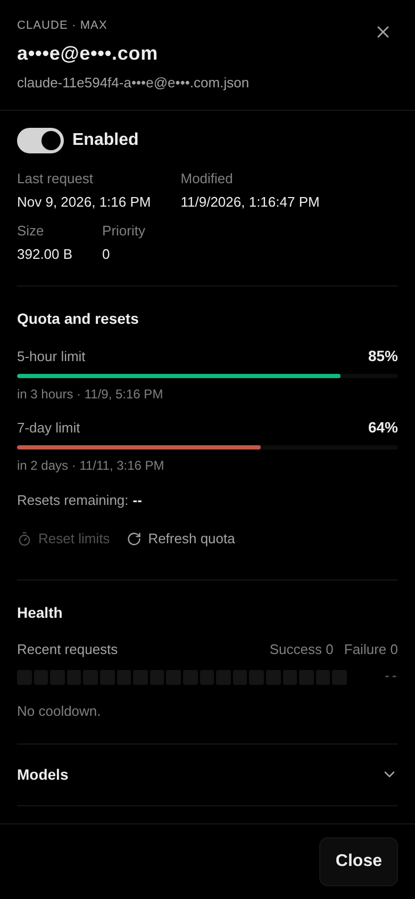](screenshots/accounts-manage-mobile.png) |
| **Usage:** cost, tokens, cache hits, and latency |  | [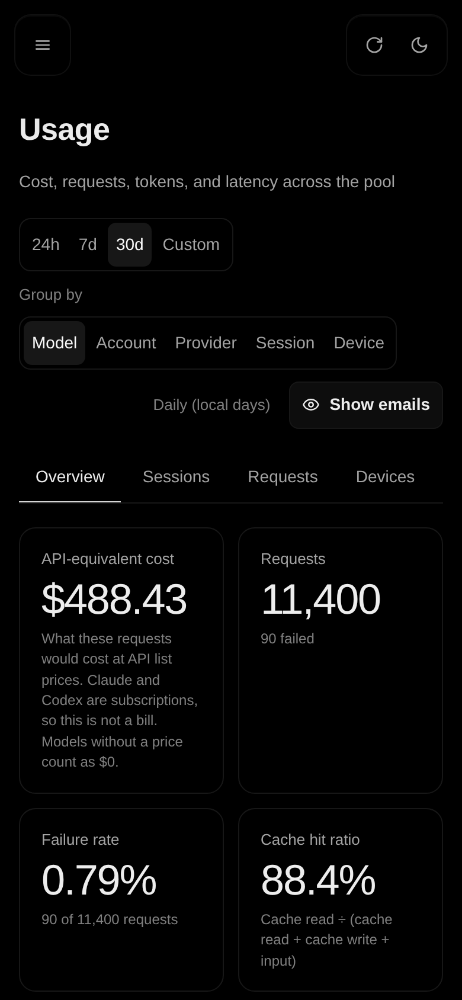](screenshots/usage-overview-mobile.png) |
| **Devices:** usage per tailnet device and the cache TTL check |  | [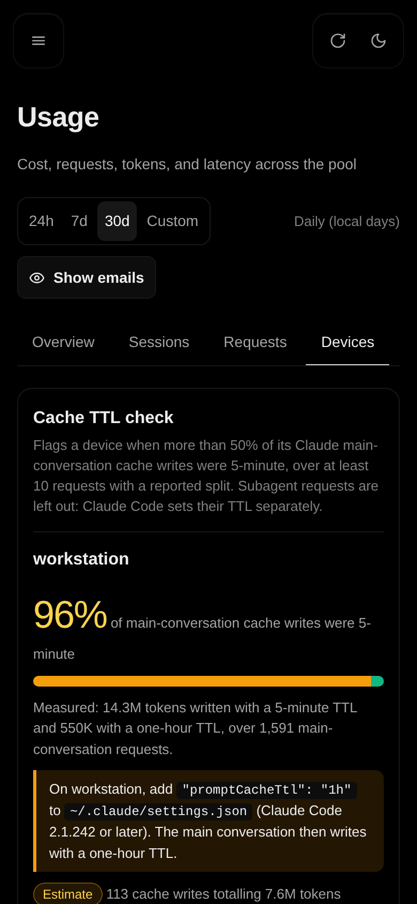](screenshots/usage-devices-mobile.png) |
| **Sessions:** session affinity and account switches |  | [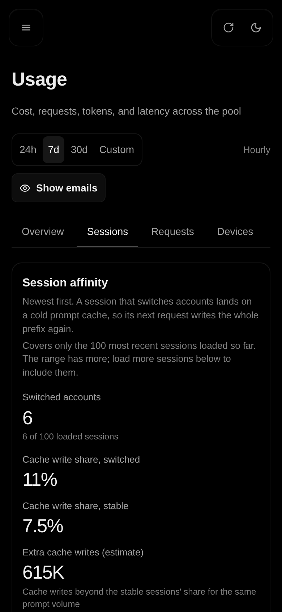](screenshots/usage-sessions-mobile.png) |
| **Request Logs:** every proxied request, compressed and searchable |  | [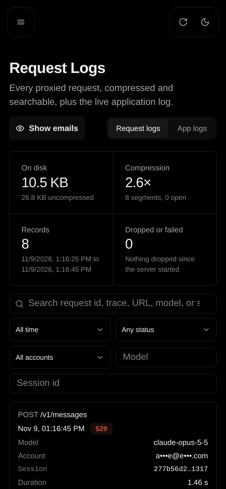](screenshots/request-logs-mobile.png) |
| **Request detail:** headers with credentials redacted, and the body |  | [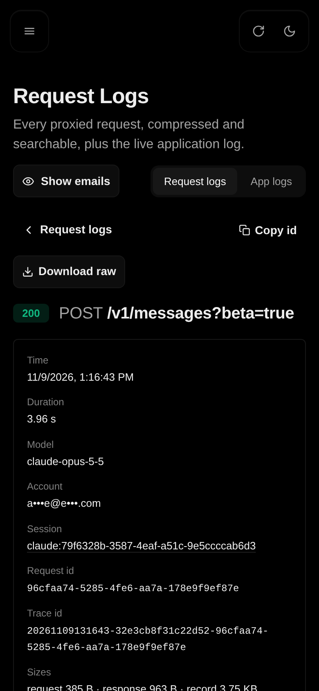](screenshots/request-log-detail-mobile.png) |
| **Routing:** soonest-reset-first and session affinity |  | [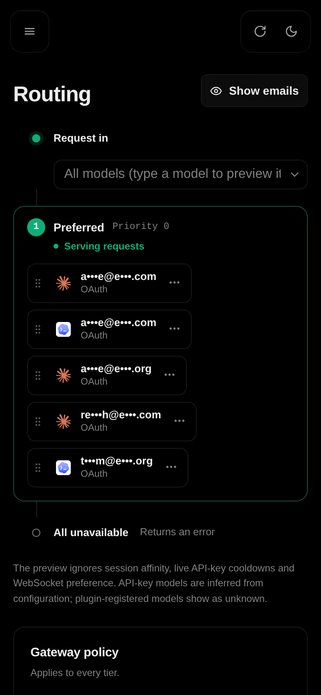](screenshots/routing-mobile.png) |
| **Backups:** scheduled and manual backups, with the next run in server time and your time |  | [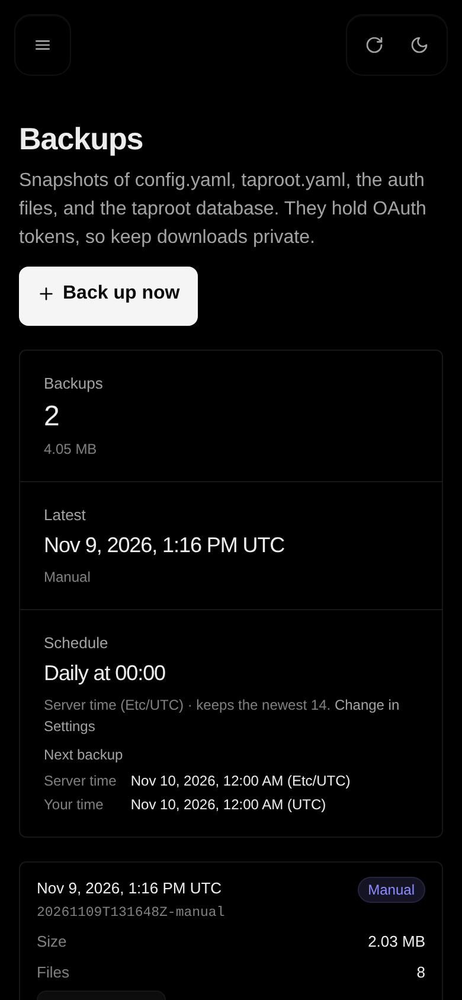](screenshots/backups-mobile.png) |
| **Access:** tailnet devices and requests, with their Proxy and Admin switches |  | [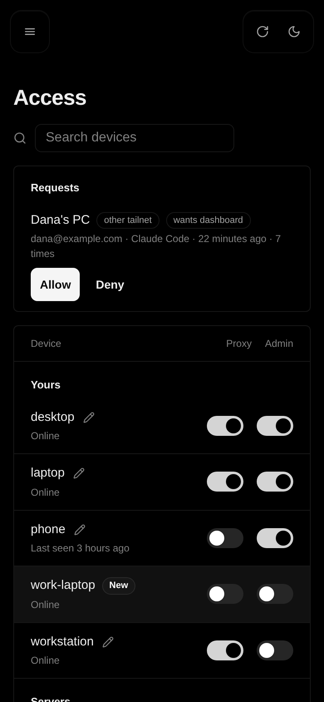](screenshots/access-mobile.png) |
| **Settings:** request logs and the backup schedule |  | [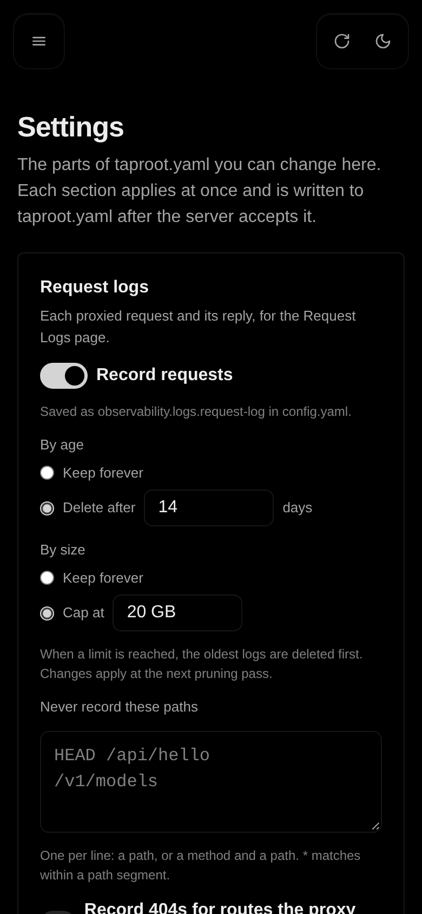](screenshots/settings-mobile.png) |
| **Light theme:** the Accounts page in the light theme |  | [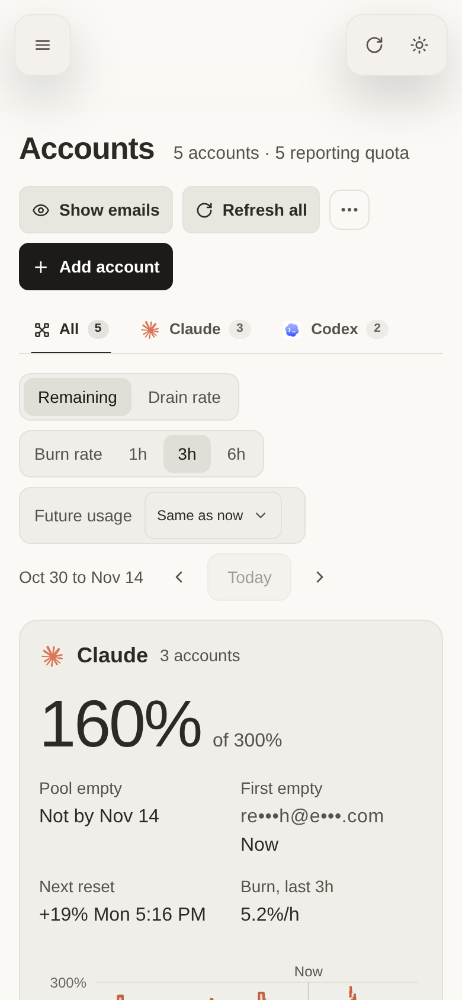](screenshots/accounts-light-mobile.png) |
